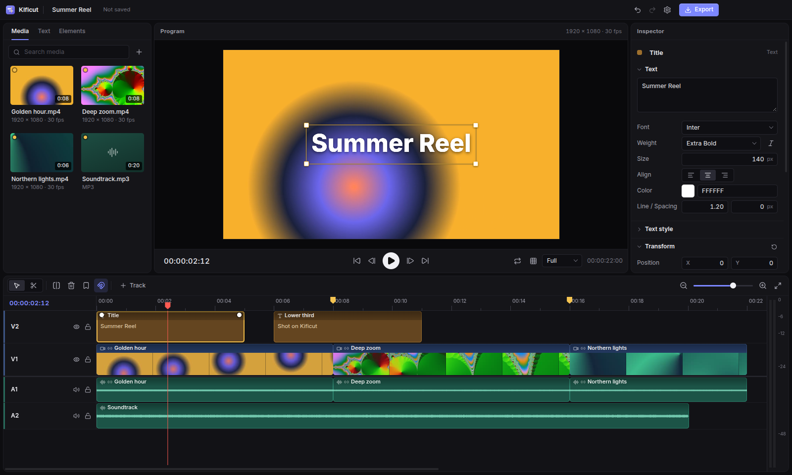

# Kificut

A free and open source video editor for Windows and macOS.



Kificut is a multi-track editor built on Electron and FFmpeg. The preview is drawn on the GPU in real time and exports go straight through FFmpeg, so what you see while editing is what ends up in the file. It also runs on Linux, though Windows and macOS are the main targets.

## Features

**Editing**

- Multi-track timeline with video, audio, image, title and color layers
- Video with sound is placed as a linked pair that moves, trims and splits together (and can be unlinked)
- Trim by dragging clip edges, split with the razor tool or at the playhead, ripple delete, duplicate, copy and paste
- Overwrite editing: dropping or moving a clip onto occupied space trims whatever was there
- Snapping to clip edges, the playhead, markers and in/out points
- Markers, in and out points, and an export range
- Full undo history, autosave, and projects that remember where their media lives

**Picture and sound**

- Position, scale, rotation, opacity, flip and crop, editable in the inspector or directly on the preview
- Brightness, contrast, saturation and gamma
- Titles in any installed font with outlines, background boxes and drop shadows
- Fade in and out on any clip, per clip volume in dB, speed from 10% to 1600% with pitch kept
- Stereo output meter

**AI, on your terms**

- Voiceovers from a script with Kokoro, 28 natural English voices, generated on your computer
- Captions from speech with Whisper in about 100 languages, also on your computer. Right click a clip and choose Generate Captions
- An assistant panel that edits with you. Bring your own key for Anthropic, OpenAI, Google Gemini or OpenRouter, or use a local model through Ollama, LM Studio or any OpenAI compatible server
- Connect Claude Desktop and ask for edits in plain language: "make a 30 second reel from the clips in my Trip folder with a title and some music". See [Use Kificut from Claude](#use-kificut-from-claude)

See [AI features](#ai-features) for what runs where.

**Media and export**

- Imports anything FFmpeg can read. Footage the preview cannot decode directly (ProRes, DNxHD, AVI, MPEG-2 and so on) gets a lightweight preview copy in the background, and exports always use the original file
- Filmstrip thumbnails and waveforms on the timeline
- Export to MP4 (H.264 or HEVC), WebM (VP9), QuickTime ProRes 422, animated GIF, MP3 and WAV, at the project size or smaller, with progress and time remaining

## Download

Installers for Windows and macOS are attached to each [release](https://github.com/Kificut-app/kificut/releases).

Release builds are not code signed yet. On macOS, try to open the app once, then go to System Settings > Privacy & Security and choose Open Anyway. On Windows, choose "More info" and then "Run anyway" if SmartScreen asks.

## AI features

Everything AI in Kificut is optional, and nothing is downloaded or sent anywhere until you turn it on. Open it with the sparkle button in the top bar.

**Models on this computer**

| Model                                                        | Used for               | Download | License                             |
| ------------------------------------------------------------ | ---------------------- | -------- | ----------------------------------- |
| [Kokoro 82M](https://huggingface.co/hexgrad/Kokoro-82M)      | Voiceovers (Voice tab) | 108 MB   | Apache-2.0, eSpeak NG under GPL-3.0 |
| [Whisper Base](https://huggingface.co/openai/whisper-base)   | Captions, transcripts  | 81 MB    | MIT                                 |
| [Whisper Small](https://huggingface.co/openai/whisper-small) | Better captions        | 254 MB   | MIT                                 |

None of these models ship with Kificut. Install the ones you want from **AI > Models on this computer**, or ask your assistant to do it ("install the voice model"): Claude Desktop and the Assistant tab can list the models and install one with the `install_ai_model` tool, and they are told to check with you first because of the download size. They are downloaded from Hugging Face at a pinned revision, every file is checked against its published hash, and they run inside Kificut with ONNX Runtime on the CPU. Your footage and scripts never leave the computer, and the models work offline once installed. Generated voiceovers are saved as WAV files in `Documents/Kificut/Generated`.

Kokoro uses eSpeak NG to turn text into phonemes. eSpeak NG is GPL licensed, so it is downloaded together with the model instead of being part of Kificut.

**Assistant with your own key**

The Assistant tab next to the Inspector is a chat that edits the open project with the same tools as the Claude connector. Pick a provider under **AI > Assistant**:

- **Anthropic** (Claude Opus 5.5 by default), **OpenAI**, **Google Gemini** or **OpenRouter** with your API key
- **Ollama** or **LM Studio** to run a model on your own computer, no key needed
- **Other**: any server with an OpenAI style `/chat/completions` endpoint, such as vLLM or LiteLLM

Keys are encrypted with the system key store (Keychain on macOS, DPAPI on Windows) and stay in Kificut's main process; the window that draws the interface never sees them. While you chat, your messages, the project details and any frames the assistant looks at go to the provider you chose. With Claude models that support it, Kificut turns on Anthropic's default refusal fallback, so a request Claude declines can be answered by another Claude model. Usage is billed by your provider to your account.

## Use Kificut from Claude

Kificut comes with a connector for [Claude Desktop](https://claude.ai/download). Once it is installed, Claude can work in Kificut on your behalf: look through your footage, find scene changes and silences, place and trim clips, add titles and music, check frames, and export. You watch the timeline change as it works, and every change can be undone with Ctrl+Z (Cmd+Z on a Mac).

**Install it**

1. Install Claude Desktop and sign in.
2. In Kificut, open Settings and click **Install in Claude Desktop** under Claude. (You can also download `Kificut-<version>-claude.mcpb` from the [release](https://github.com/Kificut-app/kificut/releases) and double-click it.)
3. Confirm the install in Claude Desktop.

**Try asking**

- "Look at the videos in ~/Movies/Lisbon and make a one minute highlight reel with a title at the start."
- "Cut the silent parts out of interview.mp4."
- "Add lower thirds with each speaker's name, then export a 1080p MP4 to my Desktop."

**Good to know**

- Kificut needs to be installed. If it is closed, the connector opens it.
- Claude sees the project details, file names and the frames it asks for. Nothing else on your computer is shared through the connector.
- It can only edit through the tools Kificut provides. Saves and exports never replace existing files, and Claude Desktop asks you before it uses a tool unless you allow it.
- You can turn access off at any time in Settings, under Claude.

## Building from source

You need [Node.js](https://nodejs.org) 20.19 or newer (22 LTS recommended) and Git.

```sh
git clone https://github.com/Kificut-app/kificut.git
cd kificut
npm install
npm run dev
```

`npm install` downloads FFmpeg for your platform through `ffmpeg-static`, and `scripts/fetch-ffprobe.mjs` fetches the matching FFprobe from the same release into `vendor/`.

| Command              | What it does                                         |
| -------------------- | ---------------------------------------------------- |
| `npm run dev`        | Start the app with hot reload                        |
| `npm run build`      | Compile main, preload and renderer into `out/`       |
| `npm start`          | Run the compiled app                                 |
| `npm test`           | Unit tests plus export tests against the real FFmpeg |
| `npm run lint`       | ESLint                                               |
| `npm run typecheck`  | TypeScript, all three projects                       |
| `npm run dist:win`   | Windows installer in `release/`                      |
| `npm run dist:mac`   | macOS DMG and ZIP in `release/`                      |
| `npm run dist:linux` | Linux AppImage in `release/`                         |

### Packaging notes

Build each installer on the operating system it targets, because the bundled FFmpeg binary is platform specific. To build for Intel Macs from an Apple Silicon machine, reinstall with `npm_config_arch=x64 npm ci` and run `npm run dist:mac -- --x64`.

Signing is handled by electron-builder. Set `CSC_LINK` and `CSC_KEY_PASSWORD` for Windows and macOS certificates, and the `APPLE_ID`, `APPLE_APP_SPECIFIC_PASSWORD` and `APPLE_TEAM_ID` variables to notarize on macOS. The CI workflow in `.github/workflows/ci.yml` builds unsigned installers for every tag that starts with `v`.

## How it works

The renderer process holds the project in a Zustand store with immutable snapshots, which keeps undo and redo cheap. Playback uses one media element per clip near the playhead, synced to a master clock and composited with a small WebGL 2 shader. The shader uses the same math as FFmpeg's `eq` filter, so color adjustments look the same in the preview and in the export. Machines without WebGL 2 fall back to a 2D canvas.

When you export, text layers are rendered to PNG in the renderer and the main process turns the timeline into a single FFmpeg filter graph. The graph builder is a pure function in `src/shared/ffmpeg-graph.ts` with its own tests.

[docs/ARCHITECTURE.md](docs/ARCHITECTURE.md) goes into more detail.

## Keyboard shortcuts

| Action                          | Shortcut                                          |
| ------------------------------- | ------------------------------------------------- |
| Play or pause                   | Space                                             |
| Shuttle back, stop, forward     | J, K, L                                           |
| Step one frame                  | Left, Right                                       |
| Previous or next edit           | Up, Down                                          |
| Split at playhead               | S or Ctrl+K (Cmd+K)                               |
| Selection and razor tools       | V, C                                              |
| Delete, ripple delete           | Delete, Shift+Delete                              |
| Set in and out                  | I, O                                              |
| Add marker                      | M                                                 |
| Zoom timeline                   | = and -, Shift+Z to fit, Ctrl+scroll at the mouse |
| Duplicate a clip while dragging | Hold Alt (Option)                                 |

The full list is under Help > Keyboard Shortcuts.

## Roadmap

These are not in yet. Help is welcome on any of them.

- Keyframes for transform, opacity and volume
- Transitions between neighbouring clips on the same track
- Audio effects such as EQ, compression and noise reduction
- Hardware encoders (NVENC, Quick Sync, VideoToolbox) without a custom FFmpeg build
- Subtitle import and export (SRT, VTT)
- Editing by transcript (select words to cut them)
- More voices and languages for voiceovers
- A ChatGPT connector
- Translations

## Contributing

Bug reports, ideas and pull requests are all welcome. [CONTRIBUTING.md](CONTRIBUTING.md) explains how to get set up and where things live.

## License

Kificut is released under the [MIT license](LICENSE).

The installers include FFmpeg and FFprobe builds published by the `ffmpeg-static` project. They run as separate programs and are distributed under their own license (GPL, since the builds include x264 and x265); a copy is included with the app and the source is available from [ffmpeg.org](https://ffmpeg.org). The Inter typeface is used under the SIL Open Font License.
